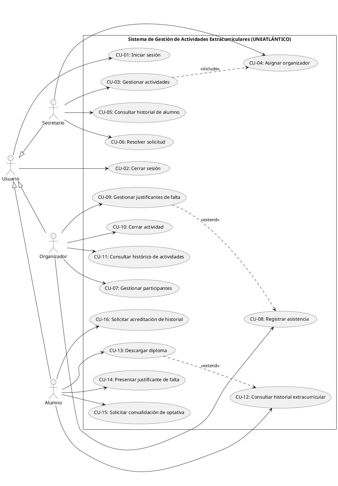

# Actores y Casos de Uso - Gestión de Actividades Extracurriculares (UNEATLÁNTICO)

Este documento recoge la identificación de los **actores**, los **casos de uso**, su **diagrama general** y el **glosario de términos** del sistema de registro y gestión de actividades extracurriculares de la Universidad Europea del Atlántico, siguiendo la disciplina de Requisitos de la metodología RUP.

---

## 1. Actores identificados

Los actores representan los roles que interactúan directamente con la plataforma. Son perfiles excluyentes entre sí asociados a una persona dentro de la universidad.

| Actor | Descripción del rol |
| :--- | :--- |
| **Usuario** *(abstracto)* | Rol general que agrupa las interacciones comunes de acceso al sistema (inicio y cierre de sesión). |
| **Secretario** | Personal de Secretaría o Administración encargado de gestionar el catálogo de actividades, asignar al organizador único de cada una, consultar los historiales del alumnado y resolver definitivamente las solicitudes de reconocimiento o acreditación. |
| **Organizador** | Responsable único asignado a una actividad concreta. Se encarga de registrar a los alumnos participantes, asignar sus roles, llevar el control de asistencia (incluyendo justificación de faltas), cerrar la actividad al finalizar y consultar el histórico de ediciones pasadas en modo solo lectura. |
| **Alumno** | Estudiante de la universidad que consulta su historial extracurricular (por ámbito y curso), comprueba su saldo global de créditos, descarga sus diplomas y presenta solicitudes de convalidación de optativa o de acreditación de historial. |

---

## 2. Casos de Uso identificados

### 2.1. Casos de Uso comunes (`Usuario`)

| ID | Caso de Uso | Descripción breve |
| :--- | :--- | :--- |
| **CU-01** | Iniciar sesión | Permite al usuario autenticarse en la plataforma con sus credenciales institucionales para acceder a su panel correspondiente. |
| **CU-02** | Cerrar sesión | Finaliza de forma segura la sesión activa del usuario en el sistema. |

### 2.2. Casos de Uso del `Secretario`

| ID | Caso de Uso | Descripción breve |
| :--- | :--- | :--- |
| **CU-03** | Gestionar actividades | Permite crear, modificar o eliminar actividades extracurriculares, asociándolas a un ámbito, curso académico, departamento y definiendo sus roles y créditos. |
| **CU-04** | Asignar organizador | Vincula un único organizador responsable a una actividad concreta para que pueda gestionarla. |
| **CU-05** | Consultar historial de alumno | Permite buscar a cualquier estudiante y visualizar su historial completo de participaciones, créditos acumulados y saldo disponible. |
| **CU-06** | Resolver solicitud | Permite revisar los datos de una solicitud pendiente (de convalidación o de acreditación de historial) para aceptarla o rechazarla, aplicando el descuento de créditos o emitiendo el certificado según corresponda. |

### 2.3. Casos de Uso del `Organizador`

| ID | Caso de Uso | Descripción breve |
| :--- | :--- | :--- |
| **CU-07** | Gestionar participantes | Permite añadir o dar de baja alumnos en la actividad que gestiona y asignarles su rol de participación correspondiente. |
| **CU-08** | Registrar asistencia | Permite marcar la asistencia de los participantes en cada sesión (presente, falta justificada o falta injustificada) y registrar las horas realizadas. |
| **CU-09** | Gestionar justificantes de falta | Permite revisar y validar los justificantes aportados por los alumnos para actualizar una falta a justificada. |
| **CU-10** | Cerrar actividad | Finaliza oficialmente la actividad, evalúa automáticamente el cumplimiento de requisitos de cada participante, concede los créditos y diplomas correspondientes y bloquea futuras modificaciones. |
| **CU-11** | Consultar histórico de actividades | Permite visualizar las actividades cerradas de cursos anteriores en modo solo lectura. |

### 2.4. Casos de Uso del `Alumno`

| ID | Caso de Uso | Descripción breve |
| :--- | :--- | :--- |
| **CU-12** | Consultar historial extracurricular | Permite visualizar todas las actividades realizadas organizadas por ámbito y curso académico, así como el estado de cada participación y el saldo global de créditos (acumulados, canjeados y disponibles). |
| **CU-13** | Descargar diploma | Permite obtener el diploma acreditativo de aquellas actividades que el alumno ha superado satisfactoriamente. |
| **CU-14** | Presentar justificante de falta | Permite adjuntar un documento o motivo para justificar una ausencia en una actividad en curso. |
| **CU-15** | Solicitar convalidación de optativa | Permite enviar a Secretaría una solicitud para canjear créditos del saldo disponible por una asignatura optativa (exigiendo el mínimo de créditos requerido por dicha asignatura). |
| **CU-16** | Solicitar acreditación de historial | Permite solicitar a Secretaría la emisión del certificado oficial de vida extracurricular con los créditos acumulados (sin exigir un mínimo concreto), habitualmente al finalizar los estudios. |

---

## 3. Modelo de Casos de Uso (Diagrama PlantUML)

---

## 4. Glosario de términos

| Término | Definición |
| :--- | :--- |
| **Actividad extracurricular** | Iniciativa formativa, cultural, deportiva o de participación estudiantil organizada por UNEATLÁNTICO fuera del plan de estudios oficial (p. ej., Liga de Debate, Aula de Teatro, Club de Lectura, deportes). |
| **Ámbito** | Categoría normativa en la que se clasifican las actividades (Deportes y actividad física; Clubes, debate y participación estudiantil; Cultura e idiomas) y que puede establecer límites máximos de créditos reconocibles. |
| **Cierre de actividad** | Acción realizada por el organizador al concluir la actividad que dispara la evaluación automática de requisitos, concede créditos y diplomas, y bloquea la edición posterior de los datos. |
| **Convalidación de optativa** | Trámite mediante el cual el alumno canjea créditos de su saldo disponible para reconocer una asignatura optativa en su expediente académico (requiere un mínimo igual a los créditos de la optativa, con referencia de 6 ECTS). |
| **Diploma** | Documento acreditativo generado automáticamente cuando un alumno supera los requisitos mínimos de una actividad concreta. |
| **Historial extracurricular** | Registro único y permanente de todas las actividades universitarias realizadas por un alumno, organizadas por ámbito y curso académico. Se conserva aunque no se solicite convalidación de créditos. |
| **Organizador** | Persona única designada por Secretaría para gestionar los participantes, roles, asistencias y cierre de una actividad específica. No puede ser un alumno. |
| **Participación** | Vínculo entre un alumno y una actividad bajo un rol concreto, que registra su estado (en curso, superada o no superada), horas, asistencias y créditos obtenidos. |
| **Rol de participación** | Papel desempeñado por un alumno dentro de una actividad (p. ej., voluntario, concursante, asistente), el cual determina los requisitos mínimos y los créditos a conceder. |
| **Saldo global de créditos** | Conjunto de créditos acumulados por el alumno a través de todas sus actividades superadas, diferenciando entre créditos disponibles para canje y créditos ya canjeados. |
| **Solicitud** | Petición formal iniciada por el alumno en la web y sujeta a validación de Secretaría, ya sea para convalidar una asignatura optativa o para obtener la acreditación oficial de su historial extracurricular. |
